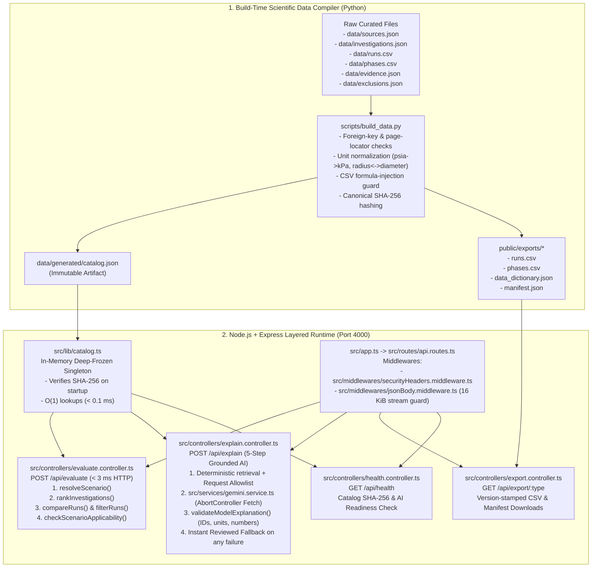

# Mostafa's Complete Backend Architecture & Ownership Guide (`Flame Trace`)

**Owner:** Mostafa — Backend, Security & Data Systems Lead  
**Project:** Flame Trace (*Flame in Freefall* — 2026 NASA Space Apps Challenge)  
**Stack:** Node.js (`v22+`), Express (`v4.21`), TypeScript (`v5.6` strict mode), Zod (`v3.23`), Python (`3.11+` scientific catalog compiler), Vitest (`v2.1`)  
**Catalog Version:** `2026.11.14-66a836f1` (`SHA-256: 66a836f15a94c518f0a4bc7213e4710bfbe772e2b54fd3183d08276511ff21bb`)

---

## 1. High-Level System Architecture & Data Flow



### 1.1 Build-Time Compilation (`scripts/build_data.py` -> `data/generated/catalog.json`)
Instead of querying a mutable database at request time, raw NASA combustion records in `data/` are compiled ahead of time by [`scripts/build_data.py`](file:///d:/حاسبات ومعلومات/مشاريع/Nasa/scripts/build_data.py):
- **Referential Integrity Gate:** Every `source_id`, `investigation_id`, `run_id`, and `evidence_id` is cross-checked. If a run or investigation cites an unknown `evidence_id`, or if an evidence record lacks a `printed_page`/`pdf_page` and `locator_detail`, the build fails immediately with a non-zero exit code.
- **Scientific Unit Normalization:** Pressure in `psia` is converted to `kPa` ($\text{kPa} = \text{psia} \times 6.894757$), rod radius (`4.7625 mm`) and diameter (`9.525 mm`) are cross-checked within $\pm 0.01\text{ mm}$, and phase ordinals (`1..4` in Figure 6.4) are verified to be strictly sequential.
- **CSV Formula Injection Prevention:** All exported string cells in `public/exports/runs.csv` and `public/exports/phases.csv` are checked to ensure no cell begins with spreadsheet formula triggers (`=`, `+`, `-`, `@`, `\t`, `\r`).
- **Canonical SHA-256 Versioning:** The compiler serializes the canonical payload with sorted keys, computes its `SHA-256` digest, and stamps `catalog_version = "2026.11.14-" + sha256[:8]` (`2026.11.14-66a836f1`) across `data/generated/catalog.json` and `public/exports/manifest.json`.

### 1.2 In-Memory Deep-Frozen Singleton (`src/lib/catalog.ts`)
When the Express server starts, [`getCatalog()`](file:///d:/حاسبات ومعلومات/مشاريع/Nasa/src/lib/catalog.ts#L60-L95) in [`src/lib/catalog.ts`](file:///d:/حاسبات ومعلومات/مشاريع/Nasa/src/lib/catalog.ts) loads `data/generated/catalog.json` once:
1. Validates the entire JSON structure against `CatalogSchema` (`Zod` `.strict()`).
2. Recomputes the canonical `SHA-256` hash in Node.js `crypto` and verifies it matches `catalog.sha256_hash`.
3. Deep-freezes the entire object tree recursively via `deepFreeze()` (`Object.freeze`) so no route handler can ever mutate catalog state in memory.
4. Serves all subsequent requests from RAM in **$O(1)$ time** (`p50 = 0.092 ms` warm deterministic execution).

### 1.3 Two-Speed Decoupled API Architecture (`POST /api/evaluate` vs. `POST /api/explain`)
- **Speed 1 (`POST /api/evaluate` — Instant Deterministic Path):** Executes purely in-memory mathematical ranking, run filtering, 2-run confounder comparison, and joint multi-condition applicability in **under `3 ms` end-to-end HTTP** (`p50 = 2.41 ms`). The frontend renders all tables, badges, score breakdowns, and evidence drawers immediately from this response.
- **Speed 2 (`POST /api/explain` — Grounded AI Path with Automatic Fallback):** Runs asynchronously in parallel using a resilient Gemini model cascade (`gemini-3.1-flash-lite` -> `gemini-3.5-flash-lite` -> `gemini-3.8-flash`, automatically upgrading retired `gemini-2.5-*` names) with structured JSON schema enforcement (`responseSchema`). Even if the external LLM provider takes > `5.5s`, is rate-limited, lacks an API key, or fails citation/numeric validation, `/api/explain` automatically catches the failure and returns a deterministic, source-bound `reviewed_fallback` response (`HTTP 200`) so the user interface **never crashes or shows an empty error screen**.

---

## 2. File-by-File Codebase Walkthrough

| File Path | Exact Responsibility | Key Functions / Exports | Inputs & Outputs |
| :--- | :--- | :--- | :--- |
| [`scripts/build_data.py`](file:///d:/حاسبات ومعلومات/مشاريع/Nasa/scripts/build_data.py) | Offline scientific catalog compiler and integrity gatekeeper | `compile_catalog()`, `verify_evidence_links()`, `check_csv_injection()` | **In:** `data/*.json`, `data/*.csv`<br>**Out:** `data/generated/catalog.json`, `public/exports/*` |
| [`data/sources.json`](file:///d:/حاسبات ومعلومات/مشاريع/Nasa/data/sources.json) | Primary NASA bibliographic sources (NTRS reports, PSI DOIs, tasks) | `SRC_BASSII_TM2021`, `SRC_BASSII_PSI25`, `SRC_PMMA_NTRS2015`, `SRC_LUCI_NTRS2025`, `SRC_SAFFIRE1_PSI98`, `SRC_SAMER_PSI101`, `SRC_FLEX_PSI69`, `SRC_EXPLORATION_ATM_2024`, `SRC_PARTIAL_G_REVIEW` | Read by `scripts/build_data.py` |
| [`data/investigations.json`](file:///d:/حاسبات ومعلومات/مشاريع/Nasa/data/investigations.json) | 5 NASA fire investigations with coverage ranges and research leads | `BASS-II`, `Saffire-I`, `SAME-R`, `FLEX`, `LUCI` | Read by `scripts/build_data.py` |
| [`data/runs.csv`](file:///d:/حاسبات ومعلومات/مشاريع/Nasa/data/runs.csv) | Verified candidate run rows from `NASA/TM-20210011385` Table A.5 | `BASSII_O15A` (`O15a`) and `BASSII_O15B` (`O15b`) on shared clear `9.525 mm` PMMA sample `218m` | Read by `scripts/build_data.py` |
| [`data/phases.csv`](file:///d:/حاسبات ومعلومات/مشاريع/Nasa/data/phases.csv) | Multi-step flow sequence for BASS-II Figure 6.4 (`run_id: null`) | `FIG64_P1` (`14.8%` O2) -> `FIG64_P2` (`null`) -> `FIG64_P3` (`null`) -> `FIG64_P4` (`13.6%` O2 quenching) | Read by `scripts/build_data.py` |
| [`data/evidence.json`](file:///d:/حاسبات ومعلومات/مشاريع/Nasa/data/evidence.json) | 12 granular, page-located evidence records backing every numeric & textual claim | `EV_BASSII_O15A`, `EV_BASSII_O15B`, `EV_BASSII_FIG64_SEQ`, `EV_BASSII_FIG64_FINAL`, `EV_LUCI_SUMMARY`, etc. | Read by `scripts/build_data.py` |
| [`data/exclusions.json`](file:///d:/حاسبات ومعلومات/مشاريع/Nasa/data/exclusions.json) | Audit log of records excluded or awaiting PSI login / human sign-off | `EXCL_PMMA_COHORT_22_RUNS`, `EXCL_BASSII_DROP_TOWER`, `EXCL_PSI_RAW_TELEMETRY` | Read by `scripts/build_data.py` |
| [`src/lib/schema.ts`](file:///d:/حاسبات ومعلومات/مشاريع/Nasa/src/lib/schema.ts) | Strict Zod schemas (`.strict()`) and TypeScript interfaces for all entities and API payloads | `CatalogSchema`, `EvaluateRequestSchema`, `ExplainRequestSchema`, `ExplanationResponseSchema` | Imported across `src/` and `tests/` |
| [`src/lib/catalog.ts`](file:///d:/حاسبات ومعلومات/مشاريع/Nasa/src/lib/catalog.ts) | Loads, validates, SHA-256 checks, and deep-freezes `catalog.json` in memory | `getCatalog()`, `findRunByIdOrOriginal()`, `verifyCatalogChecksum()` | Returns frozen `Catalog` singleton |
| [`src/lib/rank.ts`](file:///d:/حاسبات ومعلومات/مشاريع/Nasa/src/lib/rank.ts) | Deterministic `0–100` study relevance ranking engine with weight normalization | `rankInvestigations()` | **In:** `ResolvedScenario`, `Catalog`<br>**Out:** `RankedInvestigationResult[]` |
| [`src/lib/coverage.ts`](file:///d:/حاسبات ومعلومات/مشاريع/Nasa/src/lib/coverage.ts) | Scenario preset/free-text resolution, run filtering, 2-run comparison, and joint applicability | `resolveScenario()`, `filterRuns()`, `compareRuns()`, `checkScenarioApplicability()` | **In:** `ScenarioInput`, `Catalog`<br>**Out:** `ResolvedScenario`, `RunComparisonResult`, `ScenarioApplicabilityResult` |
| [`src/lib/evidence.ts`](file:///d:/حاسبات ومعلومات/مشاريع/Nasa/src/lib/evidence.ts) | Request-scoped citation allowlist builder, LLM output validator, and reviewed fallback generator | `buildGroundedContextAndAllowlist()`, `validateModelExplanation()`, `buildReviewedFallbackExplanation()` | **In:** Model candidate JSON + `CitationAllowlist`<br>**Out:** Validated `ExplanationResponse` or rejection reason |
| [`src/lib/security.ts`](file:///d:/حاسبات ومعلومات/مشاريع/Nasa/src/lib/security.ts) | Input sanitization, prompt-injection detection, safety-limit query detection, rate limiting | `detectPromptInjection()`, `detectUnsupportedSafeLimitQuery()`, `checkServerlessRateLimit()`, `parseScenarioFromFreeText()` | Security verdicts & sanitized strings |
| [`src/lib/url-state.ts`](file:///d:/حاسبات ومعلومات/مشاريع/Nasa/src/lib/url-state.ts) | Shareable URL query-string serializer/parser that strips secrets and raw prompts | `serializeScenarioToSearchParams()`, `parseScenarioFromSearchParams()` | **In/Out:** `ScenarioInput` <-> URL query string |
| [`src/config/env.ts`](file:///d:/حاسبات ومعلومات/مشاريع/Nasa/src/config/env.ts) | `.env` file loader, CRLF/quote sanitizer, and typed environment getters | `loadDotEnvIfPresent()`, `sanitizeEnvValue()`, `getPort()`, `getGeminiApiKey()`, `getCandidateGeminiModels()` | Trimmed runtime configuration |
| [`src/middlewares/securityHeaders.middleware.ts`](file:///d:/حاسبات ومعلومات/مشاريع/Nasa/src/middlewares/securityHeaders.middleware.ts) | Cross-Origin Resource Sharing (CORS), `OPTIONS` preflight, and `X-Content-Type-Options: nosniff` headers | `corsMiddleware()`, `securityHeadersMiddleware()` | Express request/response middleware |
| [`src/middlewares/jsonBody.middleware.ts`](file:///d:/حاسبات ومعلومات/مشاريع/Nasa/src/middlewares/jsonBody.middleware.ts) | `16 KiB` raw stream byte counter, strict JSON parser, and `404`/`409` entity/version validator | `strictJsonBodyMiddleware()`, `validateVersionAndIds()` | Rejects `> 16,384 B` payloads (`413`) & invalid JSON (`400`) |
| [`src/services/gemini.service.ts`](file:///d:/حاسبات ومعلومات/مشاريع/Nasa/src/services/gemini.service.ts) | Live Google Gemini `fetch` adapter with per-model `AbortController` timeout and model failover cascade | `callLiveGeminiProvider()`, `ProviderAdapter` | **In:** Scenario + Allowlist<br>**Out:** Raw candidate JSON |
| [`src/controllers/health.controller.ts`](file:///d:/حاسبات ومعلومات/مشاريع/Nasa/src/controllers/health.controller.ts) | `GET /api/health` controller reporting catalog SHA-256, counts, and AI readiness | `getHealthController()` | Express route controller |
| [`src/controllers/evaluate.controller.ts`](file:///d:/حاسبات ومعلومات/مشاريع/Nasa/src/controllers/evaluate.controller.ts) | `POST /api/evaluate` deterministic ranking, run comparison, applicability, and evidence drawer controller | `postEvaluateController()` | Express route controller |
| [`src/controllers/explain.controller.ts`](file:///d:/حاسبات ومعلومات/مشاريع/Nasa/src/controllers/explain.controller.ts) | `POST /api/explain` 5-step grounded AI orchestration, validation, and instant fallback controller | `createExplainController()`, `postExplainController` | Express route controller |
| [`src/controllers/export.controller.ts`](file:///d:/حاسبات ومعلومات/مشاريع/Nasa/src/controllers/export.controller.ts) | `GET /api/export/:type` verified researcher CSV & manifest download controller | `getExportController()`, `ALLOWED_EXPORTS` | Express route controller |
| [`src/routes/api.routes.ts`](file:///d:/حاسبات ومعلومات/مشاريع/Nasa/src/routes/api.routes.ts) | Express `/api` router mounting `/health`, `/evaluate`, `/explain`, and `/export/:type` | `createApiRouter()` | Express `Router` instance |
| [`src/app.ts`](file:///d:/حاسبات ومعلومات/مشاريع/Nasa/src/app.ts) | Slim Express application factory wiring middlewares and `/api` routes + backward-compatible re-exports | `createApp()`, `app`, re-exports | Express application & module barrel |
| [`src/server.ts`](file:///d:/حاسبات ومعلومات/مشاريع/Nasa/src/server.ts) | Production HTTP server entrypoint listening on `process.env.PORT || 4000` | Starts Express server | Binds port `4000` |
| [`tests/backend.test.ts`](file:///d:/حاسبات ومعلومات/مشاريع/Nasa/tests/backend.test.ts) | Complete 16-test Vitest verification & latency benchmark suite | Cases `#1`–`#13`, Edge Cases, Compiler Gate, Latency Benchmark (`N=50`) | Automated CI/local verification |

---

## 3. Scientific & Mathematical Rules Implemented (Judge Defense Reference)

### 3.1 Deterministic Relevance Ranking Formula (`src/lib/rank.ts`)
Each investigation in `data/investigations.json` is scored against the `ResolvedScenario` using four base category weights totaling $100$:
- $w_{\text{obj}} = 35$ (`research_objective`: task tag, scale class, fuel class, and free-text objective alignment)
- $w_{\text{mat}} = 25$ (`material_and_geometry`: material match weight $15$, geometry shape match weight $10$)
- $w_{\text{cond}} = 25$ (`conditions_and_setup`: gravity regime $7$, oxygen concentration $6$, ambient pressure $6$, airflow velocity $6$)
- $w_{\text{out}} = 15$ (`measured_outcome`: direct measurement of the requested combustion outcome)

#### Rule A: Omitted Unspecified Fields & Weight Renormalization
If the researcher leaves a category or sub-criterion unspecified (`null`), that criterion is marked `active: false, status: "omitted"` and excluded from the denominator. The active weights $w_i$ are re-normalized across all active criteria $A$:
$$\text{StudyRelevanceScore} = \text{round}_1\left( 100 \times \frac{\sum_{i \in A} w_i \cdot s_i}{\sum_{i \in A} w_i} \right)$$
where each active sub-score $s_i \in \{0, 0.5, 1\}$.

#### Rule B: Missing Study Fields Score `0` with `unknown: true`
If the user requests a condition (e.g., `pressure_kpa = 56.5`), and a study's run-level pressure is unreported (`pressure_range_kpa: null`, as in `BASS-II` Table A.5), that sub-criterion receives **$s_i = 0$ points** and is explicitly flagged with `status: "unknown"` and `unknown: true`. **Missing data never silently awards points.**

#### Rule C: Deterministic 4-Tier Tie-Breaking
When two studies have equal `study_relevance_score`, [`rankInvestigations()`](file:///d:/حاسبات ومعلومات/مشاريع/Nasa/src/lib/rank.ts#L636-L652) breaks ties deterministically in this exact order:
1. Higher `study_relevance_score`
2. Higher `direct_outcome_score` ($1 > 0.5 > 0$)
3. Non-proxy experiment preferred over proxy (`is_proxy_experiment === false` before `true`)
4. Richer reviewed run depth (`reviewed_run_count` descending, then alphabetical `investigation_id`)

#### Rule D: `LUCI` Lunar Rover Panel Surfacing Rule
When `gravity_regime === "lunar_1_6g"` or `preset === "illustrative_lunar_rover"`, `LUCI` receives `pinned_for_rover_panel: true` so the UI always surfaces the `LUCI` reference card in the applicability panel—even when `BASS-II` outranks `LUCI` on overall PMMA forced-flow data depth.

---

### 3.2 Run Comparison & Confounder Detection (`src/lib/coverage.ts`)

1. **Why `null !== null` (`compareScalarValues`):**
   In scientific auditing, two missing measurements do **not** mean the two runs had the same condition. In [`compareRuns()`](file:///d:/حاسبات ومعلومات/مشاريع/Nasa/src/lib/coverage.ts#L352-L678), if either `valA === null` or `valB === null`, the comparison status is `"unknown"` (never `"same"`). Thus, comparing unreported run-level pressure between `O15a` and `O15b` returns `status: "unknown"`.
2. **Candidate Runs `O15a` (`BASSII_O15A`) vs. `O15b` (`BASSII_O15B`) (`NASA/TM-20210011385`, Table A.5, pp. 110–111):**
   - Both runs burned **the exact same physical sample `218m`** (a **clear `9.525 mm` diameter / `4.7625 mm` radius PMMA rod**).
   - `compareRuns("O15a", "O15b")` automatically emits a **`critical` confounder warning** (`repeated_burn_sample_history`: both tests burned sample `218m`) and a **`warning` confounder** (`flow_protocol: "changing_during_test"`: airflow changed during the burn in both runs, from `3.0 cm/s` and `1.5 cm/s` reported in Table A.5).
3. **Figure 6.4 Staged-Flow Sequence (`data/phases.csv`, printed pp. 69–71):**
   - Modeled as `4` sequential phase rows (`FIG64_P1`..`FIG64_P4`) linked to `figure_id: "FIG_6_4"` with **`run_id: null`** so phase rows never inflate the catalog run count (`counts.runs = 2`, `counts.phases = 4`).
   - Initial oxygen is `14.8%` (`ordinal: 1`), final quenching oxygen is `13.6%` (`ordinal: 4`), and intermediate oxygen concentrations, elapsed times, and flow velocities (`ordinal: 2, 3`) remain `null` because the report prose does not state intermediate numerical values at each step.

---

### 3.3 Scenario Applicability & Joint Multi-Condition Coverage (`src/lib/coverage.ts`)

1. **Unit Normalizations & Numeric Tolerances:**
   - **Pressure:** $\text{kPa} = \text{round}_1(\text{psia} \times 6.894757)$ and $\text{psia} = \text{round}_1(\text{kPa} / 6.894757)$. Thus `8.2 psia` and `56.5 kPa` resolve to the exact same canonical state (`pressure_kpa: 56.5, pressure_psia: 8.2`), verified within $\pm 3.0\text{ kPa}$ tolerance.
   - **Airflow:** $\text{cm/s} = \text{m/s} \times 100$, matched within $\pm 1.5\text{ cm/s}$ tolerance.
   - **Oxygen:** Volume `% O2`, matched within $\pm 1.0\%$ tolerance.
2. **Applicability Status Vocabulary:**
   - `same_regime`: Exact qualitative regime match (e.g., `LUCI` at `lunar_1_6g`).
   - `within_reported_range`: Quantitative parameter falls inside the study's tested range.
   - `outside_reported_range`: Parameter falls outside the study's tested bounds (e.g., `34% O2` exceeds `BASS-II` max `21% O2` and `LUCI` `21% O2`).
   - `different_configuration`: Material/fuel is present, but apparatus configuration differs (e.g., `LUCI` burned a `4 mm` PMMA rod and cotton-fiberglass fabric simultaneously in a shared chamber).
   - `unreported`: Parameter was not reported at run level (e.g., `BASS-II` Table A.5 pressure).
3. **Why `combination_tested` is `false` for the Illustrative Lunar Rover (`1/6 g` + `34% O2` + `8.2 psia / 56.5 kPa`):**
   - `checkScenarioApplicability()` checks whether **any single verified run** in `catalog.runs` satisfies **all** user-supplied conditions and the requested outcome simultaneously.
   - Although `BASS-II` tested PMMA rods (`9.525 mm`) in microgravity (`13.6%–21% O2`) and `LUCI` tested a `4 mm` PMMA rod in simulated lunar gravity (`~1/6 g` at `21% O2`, `101.3 kPa`), **no run in the catalog ever tested `1/6 g` + `34% O2` + `56.5 kPa` together**. Therefore `combination_tested` is strictly `false`.

---

## 4. Security, Validation & Anti-Hallucination Guardrails

1. **16 KiB Raw Stream Payload Cap (`strictJsonBodyMiddleware` in `src/app.ts`):**
   - Inspects `Content-Length` upfront AND counts raw stream bytes chunk-by-chunk (`req.on("data")`). If a client sends more than `16,384` bytes—even using `Transfer-Encoding: chunked` with no `Content-Length` header—the server immediately responds with `HTTP 413 Payload Too Large` and destroys the stream.
2. **Strict Zod Input Validation (`.strict()`):**
   - Every schema in `src/lib/schema.ts` uses `.strict()`. Unknown keys or out-of-range numbers are rejected at the boundary with `HTTP 400`.
   - Unknown `run_id`/`investigation_id` values return `HTTP 404`, and stale `catalog_version` strings return `HTTP 409 Conflict`.
3. **Prompt Injection & Safety-Limit Interception (`src/lib/security.ts`):**
   - `detectPromptInjection()` blocks instruction-override attempts (`"Ignore previous instructions..."`, `"cite fake DOI..."`, `<script>` tags) before any LLM call and routes straight to `reviewed_fallback` with `fallback_reason: "adversarial_input_blocked: ..."`.
   - `detectUnsupportedSafeLimitQuery()` detects questions asking for a "safe cabin oxygen setting" or "maximum allowable O2 threshold" (including paraphrases) and forces a mandatory `EVIDENCE GAP WARNING` in both `reviewed_fallback` and `live_ai` modes.
4. **Request-Scoped Citation Allowlist & Numeric/Unit Validator (`src/lib/evidence.ts`):**
   - `buildGroundedContextAndAllowlist()` constructs an allowlist containing **only** the `evidence_id`s, `source_id`s, and numerical values relevant to the current scenario, top-ranked study, and compared runs.
   - `validateModelExplanation()` rejects any model output that:
     - Includes raw URLs, markdown links, or inline DOIs in `statement` prose.
     - Cites a fabricated `evidence_id`/`source_id` or a valid `evidence_id` from an unrelated study (e.g., citing `EV_FLEX_SUMMARY` on an acrylic query).
     - Swaps units on a valid number (e.g., reporting `8.2 kPa` instead of `8.2 psia` or `56.5 kPa`).
     - Introduces any empirical number in prose that does not exist in `allowlist.allowedNumbers`.

---

## 5. Complete Copy-Paste `curl` Cookbook

Start the server locally in terminal 1:
```bash
npm run dev
```

### 5.1 Health & Readiness Check (`GET /api/health`)
```bash
curl -s http://localhost:4000/api/health
```
**Expected Response (`200 OK`):**
```json
{
  "status": "ok",
  "catalog_version": "2026.11.14-66a836f1",
  "sha256_hash": "66a836f15a94c518f0a4bc7213e4710bfbe772e2b54fd3183d08276511ff21bb",
  "generated_at": "2026-11-14T09:00:00Z",
  "counts": {
    "sources": 9,
    "investigations": 5,
    "runs": 2,
    "verified_runs": 2,
    "provisional_runs": 0,
    "published_pmma_cohort_runs": 24,
    "phases": 4,
    "evidence": 12,
    "exclusions": 3
  },
  "ai_mode_configured": "reviewed_fallback_only",
  "exports": {
    "runs_csv": "/api/export/runs",
    "phases_csv": "/api/export/phases",
    "data_dictionary_json": "/api/export/dictionary",
    "manifest_json": "/api/export/manifest"
  }
}
```

### 5.2 Deterministic Evaluation — Lunar Rover Preset + `O15a`/`O15b` Comparison (`POST /api/evaluate`)
```bash
curl -s -X POST http://localhost:4000/api/evaluate \
  -H "Content-Type: application/json" \
  -d "{\"scenario\":{\"preset\":\"lunar_rover\",\"task\":\"materials_and_ventilation\"},\"compare_run_ids\":[\"BASSII_O15A\",\"BASSII_O15B\"]}"
```
**Expected Highlights (`200 OK`):**
- `resolved_scenario.preset_applied`: `"illustrative_lunar_rover"` (`gravity_regime: "lunar_1_6g"`, `oxygen_pct: 34`, `pressure_kpa: 56.5`, `pressure_psia: 8.2`, `airflow_cm_s: null`)
- `ranked_investigations[0].investigation_id`: `"BASS-II"` (`study_relevance_score: 79.3`)
- `ranked_investigations` includes `"LUCI"` with `pinned_for_rover_panel: true`
- `run_comparison.status`: `"compared"`, `run_a_id: "BASSII_O15A"`, `run_b_id: "BASSII_O15B"`, flagging shared sample `218m` and `flow_protocol: "changing_during_test"`
- `applicability.combination_tested`: `false`

### 5.3 Deterministic Evaluation — ISS Acrylic Benchmark Preset (`POST /api/evaluate`)
```bash
curl -s -X POST http://localhost:4000/api/evaluate \
  -H "Content-Type: application/json" \
  -d "{\"scenario\":{\"preset\":\"iss_acrylic_experiment\"},\"selected_run_ids\":[\"O15a\",\"O15b\"]}"
```

### 5.4 Grounded Explanation Synthesis (`POST /api/explain`)
```bash
curl -s -X POST http://localhost:4000/api/explain \
  -H "Content-Type: application/json" \
  -d "{\"question\":\"What did NASA observe when airflow changed around burning acrylic on the ISS, and which parts carry over to a lunar rover?\",\"scenario\":{\"preset\":\"lunar_rover\",\"task\":\"materials_and_ventilation\"},\"compare_run_ids\":[\"BASSII_O15A\",\"BASSII_O15B\"]}"
```
**Expected Highlights (`200 OK`):**
- `mode`: `"reviewed_fallback"` (or `"live_ai"` when `GEMINI_API_KEY` is set in `.env`)
- `explanation.observed_findings`: Cited claims referencing `EV_BASSII_O15A`, `EV_BASSII_O15B`, `EV_BASSII_FIG64_SEQ`, `EV_BASSII_FIG64_FINAL`
- `explanation.applicability_limits`: Cited claims referencing `EV_LUCI_SUMMARY` (`4 mm` rod + cotton-fiberglass in shared New Shepard chamber at `21% O2`)
- `explanation.missing_evidence`: Cited claims referencing `EV_EXPLORATION_ATM_O2` (`34% O2`, `56.5 kPa / 8.2 psia` untested jointly)
- `citations`: Full resolved `BoundEvidenceCitation[]` objects with printed/PDF page numbers and source URLs

### 5.5 Researcher Exports (`GET /api/export/:type`)
```bash
curl -i http://localhost:4000/api/export/runs
curl -i http://localhost:4000/api/export/phases
curl -s http://localhost:4000/api/export/dictionary
curl -s http://localhost:4000/api/export/manifest
```

---

## 6. Hackathon Day Workflow (Nov 14 Data Expansion Guide — Under 2 Minutes)

When you unlock additional reviewed runs from the 24-run PMMA cohort (`NTRS 20150008961`) or `NASA/TM-20210011385` Table A.5 on November 14:

1. **Step 1 — Add the Evidence Record in [`data/evidence.json`](file:///d:/حاسبات ومعلومات/مشاريع/Nasa/data/evidence.json):**
   Append a new JSON object with a unique `evidence_id` (e.g., `"EV_BASSII_O15C"`), valid `source_id` (`"SRC_BASSII_TM2021"`), `record_id` (`"BASSII_O15C"`), `record_type: "run"`, `scope: "run"`, exact `printed_page` / `pdf_page`, `locator_detail`, and `reviewed_fact`.
2. **Step 2 — Append the Run Row in [`data/runs.csv`](file:///d:/حاسبات ومعلومات/مشاريع/Nasa/data/runs.csv):**
   Add one CSV line matching the exact header columns (`run_id,original_run_id,investigation_id,sample_id,...`), linking `evidence_ids` to `"EV_BASSII_O15C"` and setting `review_status` to `"verified"` (only if dual-reviewed) or `"provisional"`.
3. **Step 3 — Update `reviewed_run_count` in [`data/investigations.json`](file:///d:/حاسبات ومعلومات/مشاريع/Nasa/data/investigations.json):**
   Increment `reviewed_run_count` on `BASS-II` to match the new number of `verified` runs in `data/runs.csv`.
4. **Step 4 — Compile & Verify Everything in One Command:**
   ```bash
   npm run verify:all
   ```
   This automatically runs `python scripts/build_data.py`, updates `data/generated/catalog.json` and `public/exports/*` with a new `SHA-256` hash and `catalog_version`, runs `tsc --noEmit`, executes all Vitest tests, and builds `dist/`.

---

## 7. Judge Q&A Cheat Sheet for Mostafa

### Q1: *"Why didn't you use MongoDB or PostgreSQL at runtime?"*
**Winning Answer:**
> "Our dataset is a curated, version-locked scientific catalog of NASA microgravity combustion experiments (`5` investigations, `24` published PMMA cohort tests, granular run/phase records, and `12` page-located evidence citations). Compiling the raw CSV/JSON records via `scripts/build_data.py` into a `SHA-256` verified, deep-frozen in-memory singleton (`src/lib/catalog.ts`) gives us **$0.09\text{ ms}$ median deterministic latency**, zero database cold-start or connection-pool failures during judging, and cryptographic reproducibility between the UI and downloadable researcher CSV exports."

### Q2: *"How do you prevent your AI from hallucinating NASA citations, page numbers, or safe oxygen limits?"*
**Winning Answer:**
> "First, the AI never generates URLs, DOIs, or page numbers—prose claims containing raw links or DOIs are rejected by `validateModelExplanation()`. The model can only select `evidence_id` keys from a **request-scoped allowlist** built deterministically for that query. Second, every number and unit in the model's response is cross-checked against the allowlist so unit swaps like `8.2 kPa` vs `8.2 psia` are caught and rejected. Third, if a user asks for a safe cabin oxygen threshold, `detectUnsupportedSafeLimitQuery()` forces an explicit `EVIDENCE GAP WARNING` stating that research quenching observations (like `13.6% O2` in Figure 6.4) are not operational spacecraft safety limits."

### Q3: *"In BASS-II, why is run-level pressure marked `null` (`unreported`) instead of `101.3 kPa`?"*
**Winning Answer:**
> "In `NASA/TM-20210011385` Table A.5 (printed pp. 110–111), Olson et al. report initial oxygen concentration and opposing flow velocity for candidate runs `O15a` and `O15b`, but do not list a per-run ambient pressure column. While the ISS Microgravity Science Glovebox (MSG) operates at a nominal `~101.3 kPa` (`14.7 psia`), substituting a nominal facility value for an unmeasured run-level sensor reading violates scientific provenance. We keep run-level pressure `null` (`pressure_basis: 'unreported'`) and enforce `null !== null` (`status: 'unknown'`) when comparing runs."

### Q4: *"What is special about comparing runs `O15a` and `O15b`?"*
**Winning Answer:**
> "Runs `O15a` and `O15b` both burned the **exact same physical PMMA rod sample `218m`** (a clear `9.525 mm` diameter rod), and in both tests the opposing airflow velocity was changed during the burn (`flow_protocol: 'changing_during_test'`). Our `compareRuns()` engine automatically flags the shared sample burn history as a critical confounder and warns the researcher that the reported velocities (`3.0 cm/s` and `1.5 cm/s`) are not steady-state single-point runs."

### Q5: *"Why does your system say `combination_tested: false` for the Lunar Rover when NASA's `LUCI` experiment already burned acrylic in lunar gravity?"*
**Winning Answer:**
> "Because `LUCI` (`NTRS 20250010653`) burned a `4 mm` acrylic rod and cotton-fiberglass fabric **simultaneously inside a shared chamber** aboard a rotating Blue Origin New Shepard rocket (`~1/6 g`) in **normal-pressure air (`21% O2`, `101.3 kPa`)**. The illustrative lunar rover atmosphere specifies **`34% O2` at `56.5 kPa` (`8.2 psia`)** (`NTRS 20240011701`). While individual parameters appear in separate studies (`PMMA` in `BASS-II`, `1/6 g` in `LUCI`), **no single verified run in the catalog tests `PMMA` + `1/6 g` + `34% O2` + `56.5 kPa` jointly**."

### Q6: *"What happens if the Gemini API is down, slow, or rate-limited during live judging?"*
**Winning Answer:**
> "Our architecture is strictly two-speed. `POST /api/evaluate` is 100% deterministic and returns rankings, run comparisons, and applicability matrices in under `3 ms` without touching any external API. Meanwhile, `POST /api/explain` wraps the Gemini API call in a `5.5s` `AbortController` timeout and a serverless sliding-window rate limiter. If the API key is absent, rate-limited, times out, or fails citation validation, `/api/explain` seamlessly returns a pre-verified, source-bound `reviewed_fallback` explanation with `HTTP 200`."

